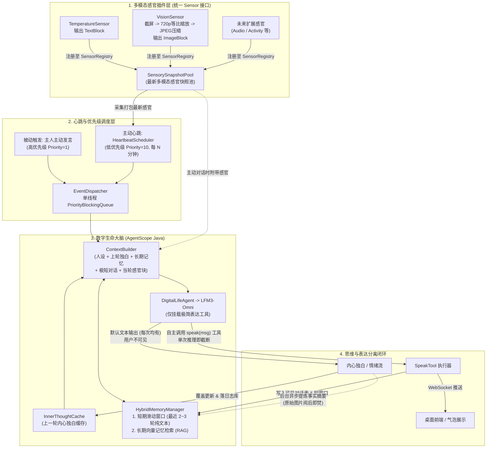
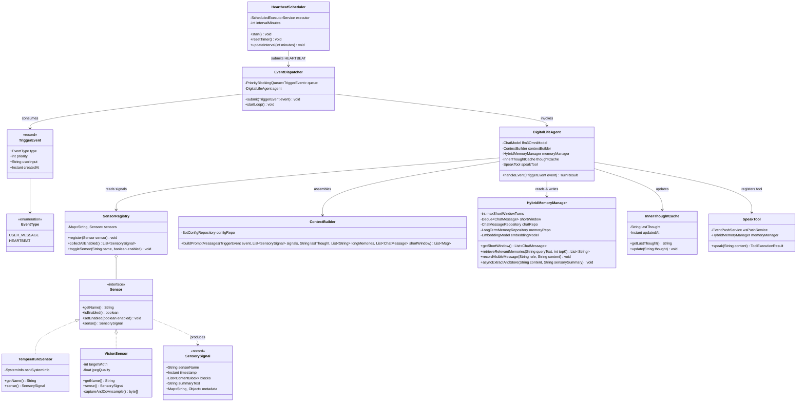

> **文档版本**：v1.1  
> **适用范围**：单人独立开发、个人电脑本地部署  
> **文档职责**：技术栈、模块划分、系统架构图（产品需求见 `PRD.md`，数据库设计见 `database.md`，接口定义见 `api.md`，开发任务见 `tasks.md`）

---

## 一、核心技术栈

| 技术领域 | 选型方案 | 选型说明与职责 |
| :--- | :--- | :--- |
| **宿主语言与运行时** | **Java 17+** | 提供稳定的跨平台桌面后台常驻能力、并发调度（`PriorityBlockingQueue` / `ScheduledExecutorService`）及强类型工程化支撑 |
| **Agent 核心框架** | **AgentScope Java** | 负责多模态消息块（`TextBlock` / `ImageBlock` / `AudioBlock`）封装、上下文组装、Tool Calling（`SpeakTool`）与单步推理钩子控制 |
| **本地多模态大模型** | **LFM3-Omni** | 本地部署的全模态模型（通过 OpenAI 兼容接口接入），同时处理文本、桌面截图与未来音频输入，生成内心独白并自主决定是否调用发言工具 |
| **感官采集组件** | **OSHI + Java AWT (`Robot` / `Graphics2D` / `ImageIO`)** | `OSHI` 读取 CPU/硬件温度；Java 标准库完成屏幕截图、720p 双线性插值等比缩放与 JPEG 压缩，零重型 Native 依赖（无需 OpenCV），单次采集 < 50ms |
| **存储与向量检索** | **SQLite 3 (`sqlite-jdbc`)** | 单文件本地数据库（`./data/digital_life.db`），零外部进程依赖；统一承载关系型配置/对话日志与本地向量余弦相似度检索（兼容 `sqlite-vec`） |
| **前后端通信与桌面端** | **REST API + WebSocket (`127.0.0.1`) + 轻量桌面前端** | 本地 HTTP 处理主动对话与配置管理，WebSocket 实现角色主动开口发言与轻状态动作的实时单向推送（前端可采用 Electron / Tauri / 轻量 Web 浮窗） |

---

## 二、系统架构图

---

## 三、模块划分与核心类设计

### 3.1 分层职责与框架边界

| 架构分层 | 载体归属 | 包含核心模块 | 核心职责 |
| :--- | :--- | :--- | :--- |
| **1. 多模态感官插件层** | 纯 Java 宿主层 | `Sensor`、`TemperatureSensor`、`VisionSensor`、`SensorRegistry`、`SensorySnapshotPool` | 采集硬件温度与桌面截图，执行 720p JPEG 降采样，封装为标准多模态块并写入快照池；支持运行期动态启停单个感官 |
| **2. 心跳与优先级调度层** | 纯 Java 宿主层 | `TriggerEvent`、`EventType`、`HeartbeatScheduler`、`EventDispatcher` | 负责定时心跳唤醒（低优先级 `Priority=10`）与用户输入入队（高优先级 `Priority=1`），通过单线程优先级队列保障并发互斥与主动发言抢占 |
| **3. 大脑与记忆层** | AgentScope Java | `DigitalLifeAgent`、`ContextBuilder`、`InnerThoughtCache`、`HybridMemoryManager` | 对接本地 `LFM3-Omni`、维护上一轮内心独白、管理短期滑动窗口（2~3 轮）与长期向量记忆检索（RAG）、组装受控 Token 预算的上下文 |
| **4. 思维与表达分离闭环层** | AgentScope + 宿主层 | `SpeakTool`、`EventPushService`、异步记忆提炼器 | 默认文本作为内心独白落库并更新缓存；仅当模型调用 `speak` 工具时推送前端消息并记录可见对话，同时立即截断 ReAct 二次推理 |

### 3.2 核心模块类图

以下类图描述了系统核心领域对象、插件扩展点以及与 AgentScope Java 的集成关系：

### 3.3 关键架构设计原则
1. **感官插件解耦**：新增听觉（`AudioSensor`）或键鼠活跃度（`ActivitySensor`）感官只需实现 `Sensor` 接口并注册到 `SensorRegistry`，`DigitalLifeAgent` 与 `ContextBuilder` 无需任何代码改动。
2. **ReAct 单次推理截断**：`SpeakTool.speak()` 执行完成后，通过 AgentScope Java 的执行钩子（Hook）或自定义单步推理循环立即终止本轮调用，不再把工具返回值二次送回 `LFM3-Omni`，确保单次唤醒仅推理 1 次。
3. **视觉阅后即焚保证**：`VisionSensor` 产出的 `ImageBlock` 仅存在于 `DigitalLifeAgent.handleEvent()` 的局部栈变量中，绝不传入 `HybridMemoryManager` 或数据库持久层。

---

## 四、关键工程约束与上下文预算

### 4.1 单轮上下文 Token 预算分配
为保证本地 `LFM3-Omni` 在有限显存下保持高注意力与低延迟，每次由 `ContextBuilder` 动态拼装的文本上下文严格控制在 **1500 Tokens 以内**（不含当轮 720p 视觉 Token）：

| 上下文区块 | 来源模块 | 预算上限 |
| :--- | :--- | :--- |
| 系统人设与 `speak` 工具规范 | `bot_config` | ~200 Tokens |
| 上一轮内心独白 | `InnerThoughtCache` | ~150 Tokens |
| 长期动态召回记忆（Top 3~5） | `long_term_memory` | ~450 Tokens |
| 极短可见对话窗口（最近 2~3 轮） | `chat_message` 内存队列 | ~500 Tokens |
| 当轮触发提示 + 感官文本块 | `SensorySnapshotPool` | ~200 Tokens |

### 4.2 核心避坑约束
1. **视觉降采样成本控制**：`VisionSensor` 仅使用 Java 标准库 `java.awt.Robot` + `Graphics2D`（双线性插值等比缩放至 720p）+ `ImageIO` JPEG 输出，不引入 OpenCV 等重型依赖，单次采集耗时控制在 **50ms 内**。
2. **工具调用异常兜底**：若轻量模型偶发 Tool Calling 格式畸形，框架层捕获异常并安全降级为“仅更新 `InnerThoughtCache`，不推送前端消息”，绝不将原始内心 OS 或异常 JSON 暴露给用户。
