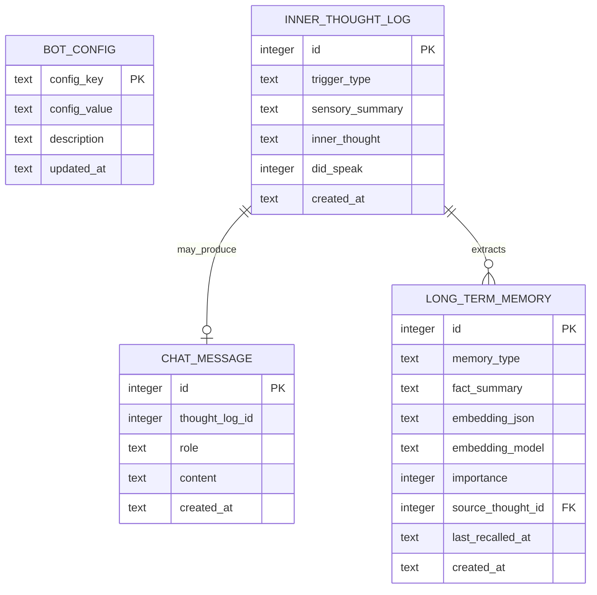

# 桌面“数字生命”数据库设计文档

> **文档版本**：v1.3  
> **存储引擎**：SQLite 3（`sqlite-jdbc`，配合 `sqlite-vec` 或本地 `float[]` JSON/BLOB 余弦相似度计算）  
> **文档职责**：ER 图、数据库表结构（产品需求见 `PRD.md`，系统架构见 `architecture.md`，接口定义见 `api.md`，开发任务见 `tasks.md`）

---

## 一、存储选型与 ER 图

### 1.1 存储选型说明
单人本地桌面常驻应用采用 **SQLite 3**（单文件数据库 `./data/digital_life.db`，开启 `WAL` 模式）：
* **零外部进程依赖**：无需安装或启动 Docker / PostgreSQL 服务，开箱即用，极致轻量。
* **向量检索方案**：在单人桌面陪伴场景下（长期记忆规模通常在百条至数万条以内），`embedding` 字段以 JSON 数组（或 `FLOAT32` 紧凑 BLOB / `sqlite-vec` 虚拟表）存储，结合 Java 内存向量余弦相似度与 `importance` 权重重排，毫秒级即可完成 Top-K 召回。

### 1.2 ER 关系图



### 1.3 实体关系说明
* **`INNER_THOUGHT_LOG` 与 `CHAT_MESSAGE`（`1 : 0..1`）**：发言时在同一事务内标记思考日志并保存 `ASSISTANT` 消息。事务要求思考记录存在且尚未发言。该关联由应用维护，主人消息的 `thought_log_id` 为 `NULL`。
* **`INNER_THOUGHT_LOG` 与 `LONG_TERM_MEMORY`（`1 : 0..N`）**：后台异步记忆提炼器从某次思考或对话中提炼出 0 至多条事实/偏好摘要，通过 `source_thought_id` 关联溯源。
* **`BOT_CONFIG`（独立配置表）**：以 Key-Value 形式存储人设、心跳频率、感官参数等运行时配置。

---

## 二、数据库表结构定义（SQLite DDL）

### 2.1 可见对话历史表（`chat_message`）

仅存储主人发送的消息以及模型通过 `speak` 工具真正说出口的消息。用于前端聊天记录展示，以及程序重启时恢复最近 2~3 轮短期滑动窗口。

#### 字段说明
| 字段名 | 类型 | 约束 | 说明 |
| :--- | :--- | :--- | :--- |
| `id` | `INTEGER` | `PRIMARY KEY AUTOINCREMENT` | 自增主键 |
| `thought_log_id` | `INTEGER` | `NULL` | 关联触发该发言的思考日志 ID（主人发送的消息为 `NULL`） |
| `role` | `TEXT` | `NOT NULL` | 发言角色：`'USER'`（主人）或 `'ASSISTANT'`（数字生命） |
| `content` | `TEXT` | `NOT NULL` | 可见对话纯文本内容 |
| `created_at` | `TEXT` | `NOT NULL` | ISO-8601 时间戳（默认 ` CURRENT_TIMESTAMP`） |

#### 建表 DDL
```sql
CREATE TABLE IF NOT EXISTS chat_message (
    id              INTEGER PRIMARY KEY AUTOINCREMENT,
    thought_log_id  INTEGER NULL,
    role            TEXT NOT NULL,                    -- 'USER' | 'ASSISTANT'
    content         TEXT NOT NULL,                    -- 可见对话纯文本内容
    created_at      TEXT NOT NULL DEFAULT (strftime('%Y-%m-%dT%H:%M:%SZ', 'now'))
);

CREATE INDEX IF NOT EXISTS idx_chat_message_created_at
    ON chat_message (created_at DESC);
```

---

### 2.2 内心独白与唤醒日志表（`inner_thought_log`）

记录每一次心跳或被动对话产生的内心独白与感官文本摘要（**严禁存储任何原始截图字节或图片路径**）。应用重启时读取最新一条记录恢复 `InnerThoughtCache`。

#### 字段说明
| 字段名 | 类型 | 约束 | 说明 |
| :--- | :--- | :--- | :--- |
| `id` | `INTEGER` | `PRIMARY KEY AUTOINCREMENT` | 自增主键 |
| `trigger_type` | `TEXT` | `NOT NULL` | 唤醒触发类型：`'HEARTBEAT'`（定时心跳）或 `'USER_MESSAGE'`（主人发言） |
| `sensory_summary` | `TEXT` | `NULL` | 感官纯文本摘要（如 CPU 温度数值、活跃状态描述，不含图片数据） |
| `inner_thought` | `TEXT` | `NOT NULL` | 模型默认输出的内心独白 / 情绪流（对用户不可见） |
| `did_speak` | `INTEGER` | `NOT NULL DEFAULT 0` | 本轮思考是否调用了 `speak` 工具对外开口（`0` 否 / `1` 是） |
| `created_at` | `TEXT` | `NOT NULL` | ISO-8601 时间戳 |

#### 建表 DDL
```sql
CREATE TABLE IF NOT EXISTS inner_thought_log (
    id              INTEGER PRIMARY KEY AUTOINCREMENT,
    trigger_type    TEXT NOT NULL,                    -- 'HEARTBEAT' | 'USER_MESSAGE'
    sensory_summary TEXT,                             -- 感官纯文本摘要（如温度数值、活跃状态）
    inner_thought   TEXT NOT NULL,                    -- 模型默认输出的内心独白
    did_speak       INTEGER NOT NULL DEFAULT 0,       -- 0: 未开口, 1: 调用了 speak 工具
    created_at      TEXT NOT NULL DEFAULT (strftime('%Y-%m-%dT%H:%M:%SZ', 'now'))
);

CREATE INDEX IF NOT EXISTS idx_thought_log_created_at
    ON inner_thought_log (created_at DESC);
```

---

### 2.3 长期记忆向量表（`long_term_memory`）

存储后台异步任务从对话或内心独白中提炼出的事实、偏好与事件摘要，供每轮上下文组装时进行语义向量召回（RAG）。

#### 字段说明
| 字段名 | 类型 | 约束 | 说明 |
| :--- | :--- | :--- | :--- |
| `id` | `INTEGER` | `PRIMARY KEY AUTOINCREMENT` | 自增主键 |
| `memory_type` | `TEXT` | `NOT NULL` | 记忆分类：`'USER_PROFILE'`（主人画像）\| `'EVENT'`（过往事件）\| `'PREFERENCE'`（偏好习惯） |
| `fact_summary` | `TEXT` | `NOT NULL` | 精简纯文本事实摘要（建议 <= 100 字） |
| `embedding_json` | `TEXT` | `NOT NULL` | 浮点向量 JSON 数组（如 `[0.012, -0.043, ...]`，兼容 `sqlite-vec` 扩展） |
| `embedding_model` | `TEXT` | `NULL` | 产生向量的 Embedding 模型。旧库升级后逐批用当前模型重新生成，文本记忆保留 |
| `importance` | `INTEGER` | `NOT NULL DEFAULT 3` | 重要度评分 `1~5`，用于向量召回后的综合重排 |
| `source_thought_id` | `INTEGER` | `NULL FK` | 关联来源 `inner_thought_log(id)`，删除时置 `NULL` |
| `last_recalled_at` | `TEXT` | `NULL` | 最近一次被召回的时间（用于遗忘衰减与近期去重） |
| `created_at` | `TEXT` | `NOT NULL` | ISO-8601 时间戳 |

#### 建表 DDL
```sql
CREATE TABLE IF NOT EXISTS long_term_memory (
    id                INTEGER PRIMARY KEY AUTOINCREMENT,
    memory_type       TEXT NOT NULL,                  -- 'USER_PROFILE' | 'EVENT' | 'PREFERENCE'
    fact_summary      TEXT NOT NULL,                  -- 精简纯文本事实摘要（建议 <= 100 字）
    embedding_json    TEXT NOT NULL,                  -- 向量浮点数组 JSON 表示
    embedding_model   TEXT,                           -- 产生向量的 Embedding 模型
    importance        INTEGER NOT NULL DEFAULT 3,     -- 重要度 1~5，用于召回综合重排
    source_thought_id INTEGER NULL REFERENCES inner_thought_log(id) ON DELETE SET NULL,
    last_recalled_at  TEXT,                           -- 最近被召回时间
    created_at        TEXT NOT NULL DEFAULT (strftime('%Y-%m-%dT%H:%M:%SZ', 'now'))
);

CREATE INDEX IF NOT EXISTS idx_long_term_memory_type
    ON long_term_memory (memory_type);
```

---

### 2.4 系统与人设配置表（`bot_config`）

键值化存储角色人设、心跳频率、感官启停状态与视觉缩放参数，支持运行时热更新。

感官每次启停写入 `sensor.<感官名>.enabled`。首次启动时如果该键不存在，使用应用配置的默认值。

#### 字段说明
| 字段名 | 类型 | 约束 | 说明 |
| :--- | :--- | :--- | :--- |
| `config_key` | `TEXT` | `PRIMARY KEY` | 配置键名（如 `'persona.prompt'`、`'heartbeat.interval_minutes'`） |
| `config_value` | `TEXT` | `NOT NULL` | 配置值（字符串或 JSON 序列化值） |
| `description` | `TEXT` | `NULL` | 配置项用途说明 |
| `updated_at` | `TEXT` | `NOT NULL` | 最后更新时间 |

#### 建表 DDL 与默认种子数据
```sql
CREATE TABLE IF NOT EXISTS bot_config (
    config_key      TEXT PRIMARY KEY,
    config_value    TEXT NOT NULL,
    description     TEXT,
    updated_at      TEXT NOT NULL DEFAULT (strftime('%Y-%m-%dT%H:%M:%SZ', 'now'))
);

-- 默认初始化配置
INSERT OR IGNORE INTO bot_config (config_key, config_value, description) VALUES
('persona.prompt', '你是一个居住在主人电脑里的数字生命伙伴，性格温和、带一点好奇心与小傲娇。你会悄悄观察主人的屏幕和电脑温度，大多数时候安静陪伴，只在真有感触或主人找你时自然简短地开口。', '角色核心人设提示词'),
('heartbeat.interval_minutes', '5', '周期性自主观察心跳间隔（分钟）'),
('vision.target_width', '1280', '桌面视觉截图等比降采样目标宽度（720p 对应 1280）'),
('bot.mute_mode', 'false', '免打扰静音模式开关（true 时不主动推送气泡）');
```

---

## 三、数据存储与隐私红线约束

1. **视觉画面绝对不落库**：`VisionSensor` 采集的屏幕图像（`byte[]` / `ImageBlock`）仅在当轮推理内存中存在，严禁以 Base64、BLOB 或本地文件路径形式写入 SQLite 任何表中。
2. **重启状态恢复机制**：
   * 应用启动时，查询 `inner_thought_log` 最新 1 条记录的 `inner_thought` 字段预热 `InnerThoughtCache`，保持重启前后的情绪连贯。
   * 查询 `chat_message` 最新 `2~3` 轮（`4~6` 条）记录预热 `HybridMemoryManager` 的短期滑动窗口。
